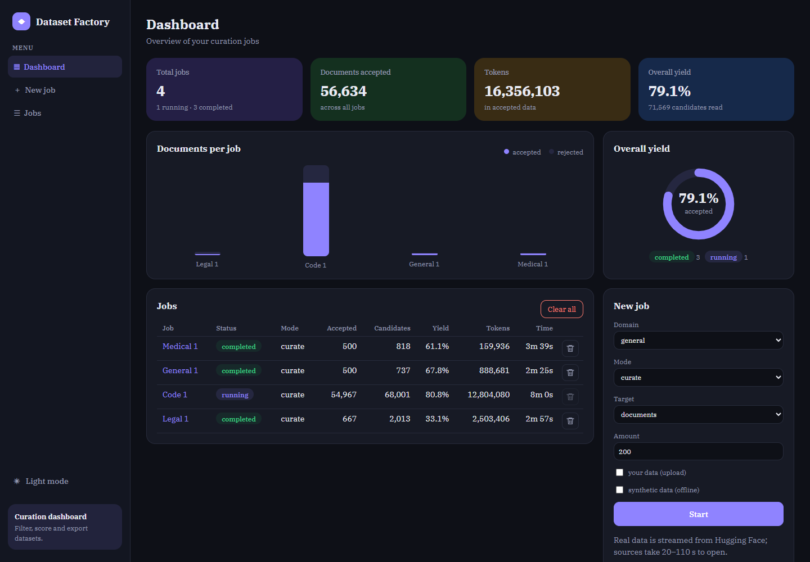
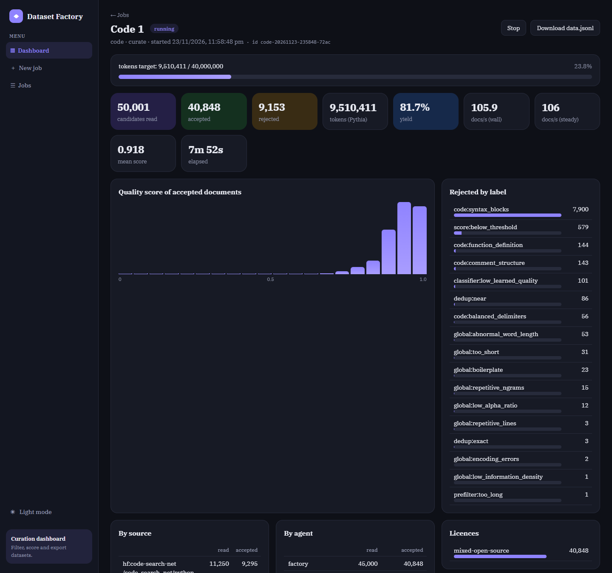
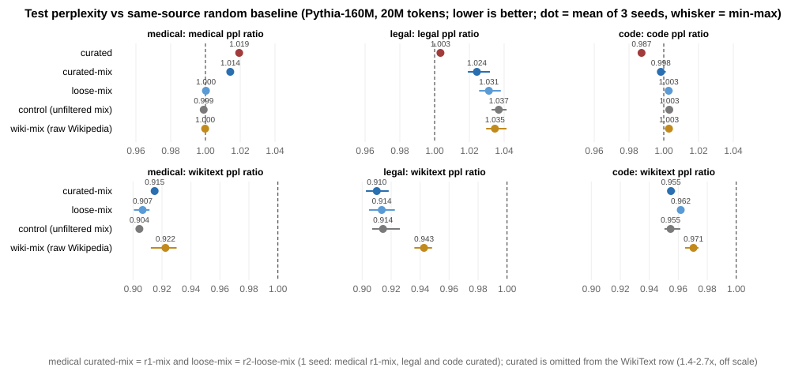

# Dataset Factory

[](https://github.com/MdMuzammilNihal/DatasetFactory/actions/workflows/ci.yml)    

A reproducible pipeline for curating domain data for LLM pretraining, plus an evaluation framework that shows **when
curation helps and when it does not**. It is a rebuild, from a college project paper, of a multi-agent curation system
for six domains (general, news, medical, legal, scientific, code); the paper guided the design, not the numbers.

Measured on Pythia-160M with 20M-token corpora: curation clearly helps for general web text, helps a little for legal
(~1.3%) and code (~0.5%) text inside a mixed corpus, and the medical filters add nothing measurable.
See [Results](#results).

## Screenshots




A finished legal job with the record browser: [docs/img/job-completed-legal.png](docs/img/job-completed-legal.png).

## Architecture

```
backend/    curation pipeline, CLI, FastAPI server       (Python package dataset_factory)
frontend/   Next.js dashboard (live jobs, records, rejections)
docker-compose.yml   API + dashboard as containers  (backend/Dockerfile, frontend/Dockerfile)
training/   corpus building, pretraining, evaluation, QLoRA, experiment runner (package dftrain, standalone)
```

**Per-document pipeline** (worker processes; all settings in `backend/config/default.toml`, unknown keys are rejected,
every record carries the config fingerprint):

    licence policy -> global filter (incl. language ID) -> domain validator -> quality score
      -> learned classifier -> PII scrub -> hash + MinHash signature -> record

Then, in the main process: deduplication (exact hash, then MinHash at 0.85) and writing.

- **Agents:** `FactoryAgent` streams 13 real Hugging Face sources, `GeneratorAgent` adds general web text (FineWeb),
  `ScorerAgent` evaluates documents. A labelled synthetic source is the offline fallback.
- **Orchestrator:** process pool, results merged in chunk order (same output for any worker count), checkpoints,
  exact resume, exact token budget with the Pythia tokenizer. Job folder `backend/runs/<job_id>/`: `config.toml`,
  `data.jsonl`, `rejections.jsonl`, `dedup.bin`, `checkpoint.json`, `manifest.json`.
- **Learned classifier:** fastText-style linear model, a pass/fail stage after scoring. Every validator check, score
  feature and stage can be switched off by name for ablations (`backend/scripts/make_ablation_configs.py`).
- **API and dashboard:** FastAPI (jobs, stop/resume, records, rejections, download, SSE progress; docs at `/docs`) and
  a Next.js dashboard with live job detail.
- **`dftrain`:** held-out eval sets, token-exact mixed corpora with decontamination, continued pretraining of Pythia,
  perplexity and PubMedQA evaluation, QLoRA, an experiment runner (seeds, summaries, paired bootstrap), Colab notebook
  (untested).

## Docker (one command)

```bash
docker compose up --build        # then open http://localhost:3000
```

Starts the API (`:8000`) and the dashboard (`:3000`). In the new-job form pick **synthetic data** for an instant
demo; real data streams from Hugging Face and takes 20-110 s per source to start. The first job downloads the
Pythia tokenizer once (cached in a volume). Stop with `docker compose down`; job results live in the `runs` volume
(`docker compose down -v` deletes them). The browser calls the API, so for another host rebuild with
`NEXT_PUBLIC_API_URL=http://<host>:8000 docker compose up --build`. Images are about 620 MB (API) and 440 MB
(dashboard); training dependencies are not included. CI builds both on every push.

## Setup

Tested on Windows 11, Python 3.13, Node 22, RTX 4060 Laptop (8 GB), 24 GB RAM. Keep the project in a short path.

```powershell
cd backend
python -m venv .venv
.venv/Scripts/python -m pip install -e ".[api,dev,train]"
.venv/Scripts/python -m pip install torch --index-url https://download.pytorch.org/whl/cu126
.venv/Scripts/python -m pip install -e "../training[train,dev]" peft bitsandbytes psutil

cd ../frontend
npm install
```

The Pythia tokenizer is downloaded to the Hugging Face cache on first use. Use `datasets` streaming for Hugging Face
data (the dataset viewer API rate-limits bulk pulls).

## How to run

**Curate (CLI, from `backend`):**

```powershell
.venv/Scripts/python -m dataset_factory curate legal --tokens 2M   # also --docs, --candidates, --mode random, --synthetic, --input f.jsonl, --sources a,b, --workers, --seed, --out
.venv/Scripts/python -m dataset_factory status runs/<job_id>
.venv/Scripts/python -m dataset_factory resume runs/<job_id>
```

`--mode random` uses the same sources with no filters, dedup or PII scrub (the same-source baseline). For a long
general job with a RAM guard: `scripts/scale_general.py --tokens 300M --workers 3 --min-free-gb 4`.

**API and dashboard:**

```powershell
cd backend;  .venv/Scripts/python -m dataset_factory serve --port 8000
cd frontend; npm run dev          # http://localhost:3000, API URL via NEXT_PUBLIC_API_URL
```

**Your own data:** on the new-job form tick "your data (upload)", pick a `.jsonl`, `.csv`, `.parquet` or `.txt` file
(max 200 MB), name the text field, set its licence and domain. The same filters, dedup and PII scrub apply. Over HTTP:
`POST /api/uploads` returns an `upload_id`, then `POST /api/jobs` with `upload_id` and `input_license`. CLI:
`curate DOMAIN --input f.jsonl`.
Uploads are listed at `GET /api/uploads` and removed with `DELETE /api/uploads/{id}` (refused while an unfinished job
reads them); the server also deletes unused uploads older than 14 days at start-up (`serve --upload-days N`, 0 = keep).

**Train and evaluate (from `training`):**

```powershell
../backend/.venv/Scripts/python -m dftrain evalsets        # held-out test sets (~1.5 min); `domainsets` for code/legal
../backend/.venv/Scripts/python -m dftrain corpus NAME --budget 19.8M --part ../backend/runs/<job_id>=0.6 --part ...
../backend/.venv/Scripts/python -m dftrain pretrain --corpus data/corpora/NAME --out data/runs/RUN
../backend/.venv/Scripts/python -m dftrain evaluate data/runs/RUN/model --out data/results/RUN.json
../backend/.venv/Scripts/python -m dftrain compare A.json B.json
../backend/.venv/Scripts/python -m dftrain qlora EleutherAI/pythia-410m --out data/runs/RUN
../backend/.venv/Scripts/python -m dftrain experiment plans/legal-160m.toml [--dry-run] [--summary-only]
```

Re-running `experiment` skips finished steps. Before long GPU runs close other GPU apps and check `tok_per_s` in
`log.jsonl` (~18-19k on the 4060 for 160M); VRAM spilling into shared memory makes training ~5x slower.

**Tests:** `cd backend; .venv/Scripts/python -m pytest -q`, `cd training; ../backend/.venv/Scripts/python -m pytest -q`
and `cd frontend; npm test` (Vitest + Testing Library: helpers, components, both pages with a mocked API and SSE).

## Verified end to end (2026-11-22)

Real data through every layer: dashboard job -> corpus -> pretraining -> evaluation (small, to show the chain works).

| step | result | time |
|---|---|---|
| curate legal, 2M tokens, from the dashboard | 813 read, 533 accepted (65.6%), 2,000,068 tokens | ~1 min |
| `corpus --budget 1.5M` | 431 docs, 6 decontaminated | 3 s |
| `pretrain --max-steps 20` (160M) | val loss 2.528, ~18.6k tok/s | 42 s |
| `evaluate --tasks wikitext,legal` | WikiText ppl 41.03, legal 17.84 | 55 s |

Twenty steps make both perplexities worse than the base model (26.01 / 16.42): too short to recover. This checks the
chain, not data quality.

## Results

Continued pretraining of Pythia-160M on ~19.8M-token corpora (604 steps); perplexity on decontaminated held-out test
sets. "Ratio vs random" is perplexity relative to a corpus from the **same sources with no filters** (paired
bootstrap; below 1 = curation helps). Mean of 3 seeds (`curated`, `no-validator`, `no-score`, `r1-mix`: 1 seed); dev
sets agree in rank; seed std of ppl is 0.00-0.35.



| arm | medical: WikiText / medical / clinical | legal: WikiText / legal | code: WikiText / code |
|---|---|---|---|
| curated (1 seed legal/code) | 1.513 / 1.019 / **0.975** | 1.405 / 1.003 | 2.720 / **0.987** |
| curated-mix (medical: r1, 1 seed) | 0.915 / 1.014 / 0.992 | **0.910 / 1.024** | **0.955 / 0.998** |
| loose-mix (medical: r2) | 0.907 / 1.000 / 1.000 | 0.914 / 1.031 | 0.962 / 1.003 |
| control-random-mix | **0.904 / 0.999** / 1.000 | 0.914 / 1.037 | 0.955 / 1.003 |
| wiki-mix (raw Wikipedia 40%) | 0.922 / 1.000 / 1.001 | 0.943 / 1.035 | 0.971 / 1.003 |

*curated* = pipeline output only; *curated-mix* = 60% curated domain + 40% curated general; *loose-mix* = validator and
score threshold off; *control-random-mix* = the random job's domain documents (web text removed) 60% + the same curated
general 40%; *wiki-mix* = unfiltered domain part 60% + raw Wikipedia 40%.

Absolute test perplexity: medical random 14.22, control 14.21, r2 14.22; legal random 15.08, curated-mix 15.44 +- 0.11,
control 15.63 +- 0.07; code random 6.30, curated-mix 6.29, control 6.32. Base Pythia-160M: WikiText 26.01, medical 15.46,
legal 16.42, code 7.11.

- **General web text: curation clearly helps.** Curated general text in a 40% share beats raw FineWeb and raw Wikipedia
  on WikiText by ~1.5-3%, with the same domain perplexity. Part of this is that Wikipedia is in-domain for WikiText.
- **Legal:** curated-mix 1.024 vs control 1.037 (~1.3%, above the seed std of ~0.7%). Curated legal alone only ties random.
- **Code:** curated-mix 0.998 vs control 1.003 (~0.5%), small but in all 3 seeds. Curation helps Go most (-3% vs
  random) and Python not at all (`code:syntax_blocks` removes the most Python).
- **Medical: the filters add nothing.** loose-mix = control = random. Strict curation narrows the data (66% PubMedQA
  abstracts): 2.0% worse on general PubMed, 1.51x worse on WikiText, 2.5% better on clinical-style text.
- Continued pretraining on any 20M corpus here makes WikiText worse than base unless a mix includes general text.

### PubMedQA and QLoRA

At 160M, PubMedQA 0-shot accuracy is **the yes/no word bias, not medical reasoning**: the paper's 55% equals always
answering "yes" (majority 55.2%), and yes-vs-no AUROC is 0.48-0.52 for every 160M model, base included. QLoRA (500
train items, 3 epochs, 0-shot test of 500) on the released models:

| model | acc % (95% CI) | macro-F1 | pred yes/no/maybe |
|---|---|---|---|
| 160M fp16, no tuning | 51.2 (46.8-55.6) | 0.26 | 444/56/0 |
| 160M QLoRA s0 | 55.2 (50.8-59.6) | 0.28 | 473/27/0 |
| 410M 4-bit, no tuning | 47.4 | 0.33 | 252/248/0 |
| 410M QLoRA s0 / s1 / s2 | 65.2 / 68.4 / 68.8 (mean 67.5 +- 2.0) | 0.46 / 0.47 / 0.47 | e.g. 280/213/7 |
| 1B 4-bit, no tuning | 55.4 (50.8-60.0) | 0.35 | 385/115/0 |
| 1B QLoRA s0 | 67.8 (63.6-72.0) | 0.47 | 309/186/5 |

160M learns only the label prior; 410M learns real signal (+10 to +14 points over majority).

### Scaling

A general curated job reached **300,000,133 tokens** (306,130 documents from 687,590 candidates, 44.5% kept, 31 min,
1.7 GB). Checked: line count = accepted, token sum matches, sha256 = manifest, no duplicate ids or texts across 3
resumes. A RAM guard stopped it three times and it was resumed each time. A 50M-token run took 314 s.
